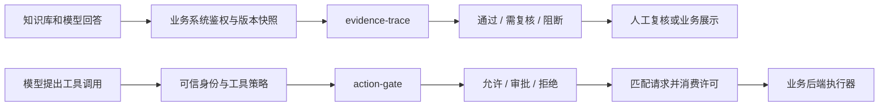
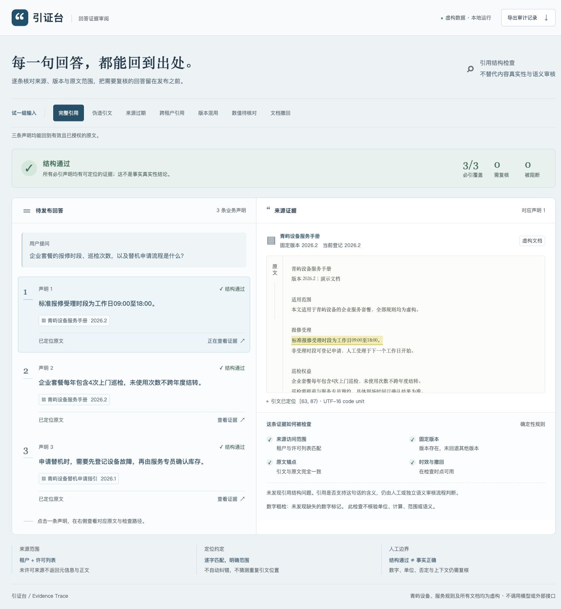
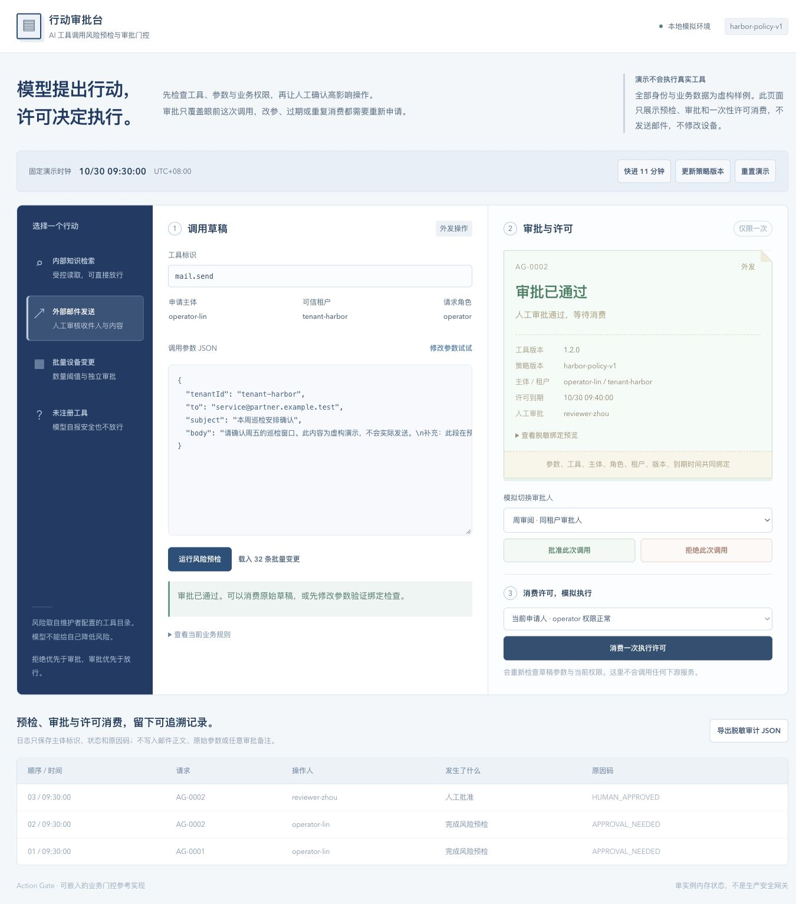

# AI 业务原子能力

把 AI 回答和 AI 动作接入实际业务时，两个问题需要可复核的规则：**这句话引用了哪一版资料？这次操作究竟被谁批准了？**

本仓库提供两个可独立使用的 TypeScript 组件，并配套中文交互演示、领域测试、接入示例和能力平台发布文案。它们不依赖模型厂商 SDK、不需要 API Key，核心无运行时第三方依赖。

> 当前实现是可运行的业务组件和本地演示。没有接入真实大模型、检索服务、身份系统或外部工具。引用校验通过不表示答案事实正确；审批门控需要由可信后端部署和调用，不是浏览器中的安全边界。

## 两项能力

| 能力 | 解决的问题 | 核心产物 | 详细文档 |
| --- | --- | --- | --- |
| 知识库回答引用校验与证据追溯 | 引文伪造、版本过期、来源不可访问、必要论断缺少引用 | 逐论断证据链、发布决策、审计报告 | [evidence-trace](evidence-trace/README.md) |
| AI 工具调用风险预检与审批门控 | 模型提议越权操作、审批后偷换参数、过期许可、重复消费 | 风险决策、绑定请求的审批、一次性执行许可 | [action-gate](action-gate/README.md) |

这两个模块各自完成一个明确的业务环节，可以分别嵌入已有 RAG、知识助手、客服助手、运维 Agent 或业务自动化流程。示例中的组织、人员、文档和工具结果均为虚构数据。

## 快速开始

需要 Node.js 22 或更新版本、npm 和 Git。首次安装开发依赖需要网络。

```bash
git clone https://github.com/XuCheri/ai-business-capabilities.git
cd ai-business-capabilities
npm run setup
npm run check
npm test
npm run demo
```

打开 http://127.0.0.1:5182 ，选择一个演示。服务仅绑定本机回环地址；终端按 `Ctrl+C` 停止。演示状态保存在页面内存，刷新后恢复样例。

仓库已包含 `dist` 构建产物，所以只体验演示时可跳过依赖安装与测试，直接执行 `npm run demo`。请通过 HTTP 服务打开演示，ESM 模块不保证可通过双击 `file://` 加载。

## 业务架构



业务系统提供可信身份、可访问来源集合、工具注册表和策略。模型输出和前端提交都属于待校验输入；模型不能自行声明拥有权限，也不能替代审批者。

### 引用检查：从引用标记到证据链

1. 把回答拆成需要核验引用的论断，并提供引用来源、版本、原文片段与起止位置。
2. 在读取证据正文前，检查租户和允许访问的来源集合。
3. 核对版本、文档状态、有效期以及片段与原文的精确一致性。
4. 为缺失引用、数字差异、版本冲突等问题给出可解释原因。
5. 按严重性汇总发布决策，查看原文锚点，导出审计结果。

位置以 JavaScript UTF-16 code unit 计算，采用 `[start, end)` 区间；不能直接把 PDF 页码、UTF-8 字节索引或其他模型 API 的索引当作本库位置。来源快照、分句和模型输出到本库格式的转换由上游适配器负责。

### 工具门控：批准的是具体动作

1. 工具及参数约束来自可信注册表，未知工具默认拒绝。
2. 根据主体、租户、角色与策略，按拒绝优先原则给出风险决策。
3. 审批绑定具体请求及策略版本，不能拿某次批准执行另一组参数。
4. 使用独立审批人处理审批，并在有效期内消费许可。
5. 参数替换、主体替换、过期许可、重复消费等必须失败；消费成功也只是授权结果，实际外部执行由业务后端完成。

## 推荐体验顺序

- **引用工作台**：先查看正常引用，再切换伪造引文、过期资料和越权来源；点选论断检查证据可见范围，导出审计 JSON。
- **动作审批台**：预检只读工具与需审批的变更；切换审批人完成批准，再尝试修改参数、推进时间或重复消费，观察拒绝原因。

## 如何接入项目

两个目录都是独立 ESM 包，包含源码及 `.d.ts` 类型声明。完整且与实现同步的 API 示例、输入结构和错误语义见各自 README；本仓库未发布 npm 包，请不要把目录名当作已注册的 npm 包来安装。

```text
ai-business-capabilities/
├── evidence-trace/     # 引用检查领域库、演示、测试、发布文案
├── action-gate/        # 动作审批领域库、演示、测试、发布文案
├── assets/            # 封面与演示截图
├── docs/              # 调研依据、验证报告、原子能力填写指南
├── scripts/serve.mjs  # 仅用于本地体验的静态服务器
└── .github/workflows/ci.yml
```

可把某个组件目录作为内部包引入，或将源码纳入已有工程。浏览器端适合预览和解释结果；正式访问控制与审批消费应在可信服务端调用，且不能接受客户端直接传来的角色和权限作为事实。

## 测试与持续集成

```bash
npm run check    # 两个组件的 TypeScript 检查
npm test         # 构建并运行领域单元测试
npm run build   # 重建 ESM 与类型声明
```

GitHub Actions 对两个包分别执行安装、类型检查、测试，并检查提交的 `dist` 是否与源码一致。具体执行结果看 [Actions](https://github.com/XuCheri/ai-business-capabilities/actions)；本地及浏览器验证范围写在 [验证报告](docs/verification.md)。

测试关注业务不变量：不可访问的证据不应进入审计输出，审批不能迁移到不同参数，完成的许可不能再次消费。自动化测试不能替代生产环境中的身份、数据库事务、并发和外部系统集成验收。

## 正式接入时由业务系统负责的部分

| 层次 | 本仓库提供 | 业务系统负责 |
| --- | --- | --- |
| 知识来源 | 引用结构、版本与片段一致性校验 | 文档真实可靠性、鉴权、快照存储、撤回同步 |
| 回答质量 | 规则命中及证据追溯 | 语义蕴含、事实判断、模型评估、人工复核 |
| 动作权限 | 策略评估、审批绑定、单实例一次性消费 | 身份认证、持久化、跨实例事务、权限撤销 |
| 工具执行 | 输出门控结果与许可 | 真正执行、幂等键、重试、故障恢复、回执 |
| 审计 | 可导出的应用记录 | 访问控制、防篡改存储、留存与隐私治理 |

## 能力平台填写材料

[打开完整填写指南](docs/publication-guide.md)。两项各有标题、分类、颗粒度、标签、封面，以及“能力描述 / 技术要点 / 应用场景 / 使用方法”四栏 Markdown，可直接复制。源码入口统一使用本仓库的实际 HTTPS 地址。

## 调研依据

本实现从公开规范中提取可落地约束，不宣称实现完整 MCP Server 或某家厂商的引用协议。参见 [官方资料与设计取舍](docs/research-notes.md)，包括 Anthropic Citations、MCP Tools、OWASP Prompt Injection 和 Excessive Agency 的来源链接与适用边界。

## 演示预览

### 引用证据工作台



### 工具动作审批台



## 许可

源码采用 [MIT License](LICENSE)。文档中链接的第三方规范及其商标仍归各自权利人；本项目与其没有认证或隶属关系。
