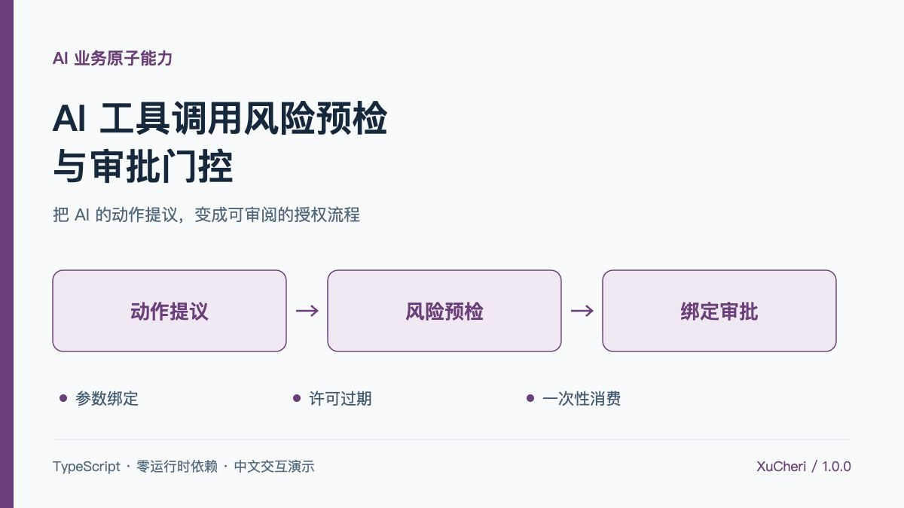
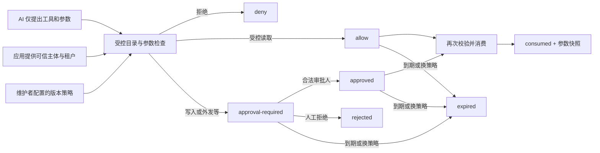

# AI 工具调用风险预检与审批门控

**让 AI 提出的行动，先通过业务权限与人工审批，再获得一次性执行许可。**



Action Gate 是一个零运行时依赖的 TypeScript / ESM 业务组件。它把受控工具目录、严格参数检查、租户与角色约束、人工审批和一次性许可消费连接成可复核的流程。附带中文交互演示、28 项自动化测试、可运行示例及四栏发布文案。

> 本项目是单实例内存参考实现，不是生产安全网关。它不调用模型、不执行真实工具、不提供登录和持久化。演示中的邮件、设备和身份全部为虚构样例。

## 解决什么问题

接入工具的 AI 助手会产生业务动作：查知识库、给合作方发邮件、批量修改设备。模型生成的参数格式正确，并不代表当前人员有权执行；用户同意一次，也不等于后续改了参数还能继续使用原审批。

Action Gate 关注具体的失效场景：

| 场景 | 组件行为 |
| --- | --- |
| 模型调用未注册工具，并声称自己是“只读” | 工具目录找不到，直接拒绝；风险取自维护者配置 |
| 使用其他租户的资源参数 | 检查受控租户字段与可信主体租户是否一致 |
| 当前角色没有该工具的申请权限 | 在策略评估前拒绝 |
| 外发、写入或破坏性动作 | 至少需要另一位同租户审批人确认，allow 规则不能降低此基线 |
| 审批后修改收件人、正文或深层字段 | 原审批绑定失配，拒绝消费；必须重新预检 |
| 审批人是申请人、跨租户或没有审批角色 | 拒绝此次审批尝试，保留原申请状态 |
| 重复消费、到期或策略已更新 | 拒绝旧许可，不自动续期或重试 |
| 有效审批下，当前申请角色已被撤销 | 消费前重新检查调用方提供的可信主体权限 |

## 五分钟体验

```bash
git clone https://github.com/XuCheri/ai-business-capabilities.git
cd ai-business-capabilities/action-gate
npm ci
npm run check
npm test
npm run demo
```

需要 Node.js 20.19+。默认打开 **http://127.0.0.1:5188**；首次安装 TypeScript 开发依赖需要联网。页面本身不访问模型或业务服务。

建议按以下路线体验：

1. **外部邮件**：运行风险预检 → 同租户审批人批准 → 消费许可，结果明确标注“模拟执行”。再点消费，会拒绝重用。
2. **审批后的改参**：重新预检并批准 → 点击“修改参数试试” → 消费被 `BINDING_MISMATCH` 拒绝。错误尝试不会烧掉原始内容的合法许可。
3. **审批身份**：切换为申请人、其他租户或没有审批角色的人员，尝试批准。
4. **批量变更**：载入 32 条变更后预检，命中超过 20 条的拒绝规则；人工审批无法覆盖直接拒绝。
5. **有效期与策略**：快进 11 分钟，或更新策略版本，未消费许可失效。
6. **权限撤销**：批准后，把消费主体切换为“operator 权限已撤销”，消费会再次拒绝。

`npm run demo:build` 生成 `demo-dist` 静态目录，可部署到 HTTP 静态服务器。浏览器 ES Modules 需要 HTTP；不要把双击 `index.html` 的 `file://` 加载失败误认为业务失败。停止本地服务使用 Ctrl+C。

## 架构与状态机



`deny`、`rejected`、`consumed`、`expired` 为终态。批准不延长到期时间；拒绝后不能直接反悔改为批准，必须重新预检。到期在 `inspect/list/approve/reject/consume` 时惰性检查，`now >= expiresAt` 即失效，不启动后台定时器。

## 为什么审批不能被复用

许可绑定以下完整信息：

```text
工具 ID + 受控工具版本 + 策略版本
+ 主体 ID + 租户 ID + 排序去重后的角色快照
+ 规范化完整参数 + 原始 expiresAt
```

私有内存保存规范化参数的完整字符串，通过精确比较验证绑定；没有使用短哈希或把客户端可修改的摘要当作授权依据。对象键排序，数组顺序保留，字符串内容不做模糊归一化。换个对象字段顺序不影响许可，修改深层正文、数组顺序或任一主体字段都会影响。

工具调用最外层只允许 `toolId` 和 `args` 两个数据字段；拒绝 getter/setter 等访问器，先固定工具身份，再检查参数。参数内部也拒绝访问器、危险原型字段、非普通对象、函数、Symbol、BigInt、循环引用、稀疏数组、非有限数字以及资源上限外的结构。

消费时重新验证当前主体角色、租户、参数约定和当前策略，随后在同一个同步调用里将状态改为 `consumed`。返回冻结的 `ExecutionPermit.args`，下游适配器应执行这个确切快照，避免检查后又从可变草稿读取参数。

**一次性消费不等于下游业务恰好执行一次。** 进程崩溃、网络超时、队列重试与跨实例并发，需要后端事务、幂等键和执行结果存储配合。

## 工具注册、参数与规则

工具目录由应用维护者控制，不从模型生成文本、模型自报风险或不可信工具描述中动态建立。

```ts
type ToolRisk = 'read' | 'write' | 'external' | 'destructive';
```

每个工具有 ID、版本、风险、参数约定、申请/审批角色、租户参数路径，可选允许的租户清单。非读取工具的审批基线始终存在；策略只可提高限制，不能用 `allow` 降低写操作审批要求。

多个规则同时命中时，固定执行 **deny > approval-required > allow**，不受数组顺序影响。规则可按工具、风险、主体角色以及参数条件匹配：等于、不等于、数值大于、数组长度大于、包含于集合、不包含于集合。一个规则内的条件是“全部满足”。

参数约定使用项目自定义的 `ArgumentSchema` 子集，**不是完整 JSON Schema 校验器，也不是完整 MCP 协议实现**：

| 类型 | 支持的约束 |
| --- | --- |
| object | properties、required；始终拒绝未声明字段 |
| string | minLength、maxLength、enum；不做隐式类型转换 |
| number / integer | minimum、maximum；只接受有限值 |
| boolean | 只接受 true / false |
| array | items、minItems、必填 maxItems；递归检查元素 |
| 所有字段 | sensitive 标记，用于审批记录中的脱敏预览 |

JSON 参数上限为 16 层、10,000 节点、128 KiB UTF-8。输入应来自经过传输解析的 JSON，而不是任意可执行 JavaScript 对象；组件不提供 JavaScript 沙箱。

## 完整接入示例

以下代码可保存为包目录内的 `quickstart.mjs`，在 `npm run build` 后执行 `node quickstart.mjs`。它只获取许可，不发送邮件。

```js
import { ActionGate } from './dist/index.js';

const gate = new ActionGate({
  tools: [{
    id: 'mail.send', version: '1.0.0', label: '外发邮件', risk: 'external',
    requesterRoles: ['operator'], approverRoles: ['approver'],
    tenantArgumentPath: ['tenantId'],
    schema: {
      type: 'object', required: ['tenantId', 'to', 'body'],
      properties: {
        tenantId: { type: 'string', minLength: 1, maxLength: 64 },
        to: { type: 'string', enum: ['service@partner.example.test'] },
        body: { type: 'string', minLength: 1, maxLength: 4000, sensitive: true }
      }
    }
  }],
  policy: { version: 'policy-v1', ttlMs: 600_000, rules: [] }
});

// 生产中必须从登录态/后端权限服务读取，不能使用模型参数里的身份。
const requester = { id: 'operator-lin', tenantId: 'tenant-harbor', roles: ['operator'] };
const reviewer = { id: 'reviewer-zhou', tenantId: 'tenant-harbor', roles: ['approver'] };
const call = {
  toolId: 'mail.send',
  args: { tenantId: 'tenant-harbor', to: 'service@partner.example.test', body: '演示消息' }
};

const request = gate.preflight(call, requester);
console.log(request.state); // approval-required
gate.approve(request.id, reviewer); // 应由独立审批页面对应的后端动作调用
const permit = gate.consume(request.id, call, requester);
console.log(permit.toolId, gate.inspect(request.id).state); // mail.send consumed

// 在真实执行入口，把 permit.args 交给固定白名单适配器。
// 本例不执行下游动作。不要把模型返回的任意函数名直接拿去执行。
```

仓库另带 `examples/basic.mjs`，用断言展示审批、改参拒绝、正常一次性消费、二次消费拒绝和精确到期边界：

```bash
npm run build
node examples/basic.mjs
```

### 已有 AI 调用链的接入位置

1. 将模型输出解析为 `{ toolId, args }`，不要把模型文本用于生成工具目录、角色或租户身份。
2. 从服务端认证上下文取得 `Principal`，交给 `preflight`。deny 直接返回业务原因，approval-required 进入待审批流程。
3. 审批页面必须展示这次调用的完整、准确内容。敏感正文可在受控区域展示；`preview` 是脱敏摘要，不能单独替代业务审核所需内容。
4. 审批 API 使用真实审批人身份调用 `approve/reject`，不要让前端自由填写 ID 和角色。
5. 唯一执行入口使用当前最新授权主体调用 `consume`，只执行返回的冻结参数，成功消费前不进行任何外部副作用。
6. 下游服务继续进行资源级授权、业务验证和幂等处理。租户参数一致不代表每个资源 ID 的实际归属已被验证。

## API 参考

| API | 说明 |
| --- | --- |
| `new ActionGate({tools, policy, now?, idFactory?, maxActions?})` | 创建独立门控实例；默认 now 为 Date.now，ID 为 crypto.randomUUID，记录上限 10,000 |
| `preflight(call, principal)` | 返回 ActionRecord，状态为 allow / deny / approval-required |
| `approve(id, approver)` | 验证同租户、审批角色、非自批、未过期，转 approved |
| `reject(id, approver)` | 同样校验审批身份，转 rejected |
| `consume(id, call, principal)` | 重新校验并一次性消费，返回冻结 ExecutionPermit；失败抛 GateError |
| `inspect(id)` / `list()` | 获取冻结记录快照，顺便检查过期；只供可信后端或受控管理代码调用 |
| `audit()` | 获取脱敏审计条目快照，不包含原始参数或自由文本审批备注 |
| `replacePolicy(policy)` | 使用不同版本号替换策略，所有未消费的可用/待批/已批记录立即失效 |
| `catalog` / `policyVersion` | 只读受控工具目录与当前策略版本 |
| `canonicalize(value)` | 严格 JSON 规范化，可用于检查对象键顺序等行为 |
| `validateArguments(value,schema)` | 对已经规范化的 JsonValue 执行自定义参数子集检查，返回路径与原因码 |

`ActionRecord` 包含请求 ID、工具版本、风险、主体快照、策略版本、状态、创建/到期时间、匹配规则、原因码、脱敏预览、审批人和消费时间。`ExecutionPermit` 包含绑定身份、版本、消费时间与冻结参数。

常见错误码：`INVALID_CALL`、`NOT_AUTHORIZED`、`SELF_APPROVAL_DENIED`、`APPROVER_TENANT_MISMATCH`、`APPROVER_ROLE_DENIED`、`BINDING_MISMATCH`、`REVALIDATION_DENIED`、`ALREADY_CONSUMED`、`EXPIRED`、`ACTION_NOT_FOUND`、`CLOCK_INVALID`。错误尝试不改变原有合法许可，除非许可确实已经过期或被策略更新撤销。

## 审计与数据保护

审计保存时间、事件、请求 ID、工具 ID、主体/租户 ID、策略版本、状态和机器原因码，不保存正文、原始参数和任意自由文本备注。记录预览根据 `sensitive` 字段隐藏内容，并对 password/token/secret 等字段名做额外隐藏。应用仍需按实际业务补充敏感字段标记。

身份 ID 与租户 ID 并非匿名数据，日志存取权限、保留期限和导出控制由应用负责。参数本体仍存在于私有绑定内存和成功返回的许可中；日志脱敏不等于全流程不处理敏感数据。传输解析错误或调用 envelope 非法发生在记录建立前，不一定形成实例内审计事件，应由 API 层补充边界日志。

## 验证与生产限制

- **已验证**：28 项 Node 测试，含深层改参、字段顺序、数组顺序、申请与审批分离、跨租户、角色撤销、精确过期、策略更新、一次性竞争消费、危险字段/getter 回归和审计脱敏。类型检查、示例执行、核心与静态演示构建通过。
- **单实例一致性**：无 `await` 的检查并标记操作只保证当前 JavaScript 实例内的消费原子性。多个进程、服务器、浏览器标签页之间不共享状态，不能把本地内存结构当分布式锁。
- **持久化与恢复**：刷新/重启会丢失状态，无序列化恢复 API；许可 ID 不是可离线验证的签名票据。真实系统需数据库事务、唯一消费约束、持久化事件与幂等执行。
- **身份与资源授权**：Principal、工具目录、策略、审批 API 和查看接口都必须由可信后端保护；库不认证用户。只核对声明的租户字段，不查询资源实际归属，也不校验远端 URL 或阻止 SSRF。
- **执行边界**：必须接入所有真实工具的唯一执行路径；绕开本组件直接调下游不在保护范围。获取 permit 后真实工具仍可能失败，不会自动回滚消费或重试。
- **审计与容量**：默认最多 10,000 条请求记录，达到上限明确拒绝新申请；审计在内存累积，生产需限流、存储与保留策略，避免无界拒绝尝试造成内存增长。
- **时间与生命周期**：注入的时钟必须为非回退的非负毫秒时间，TTL 为 1 秒至 24 小时。核心没有计时器、监听、后台进程或网络连接，无需 destroy；演示下载使用后会撤销对象 URL。

开发依赖仅固定版本 TypeScript 5.9.3，运行时零依赖。`npm audit` 在本次构建环境下为 0 漏洞，这并不替代生产系统安全评审。

## 文件结构

```text
action-gate/
├── src/                  核心门控与严格 JSON / 参数校验
├── test/                 可复核的业务与边界测试
├── examples/basic.mjs    带断言的接入示例
├── demo/                 中文交互页面与虚构工具目录
├── scripts/              本地 HTTP 服务与静态打包脚本
├── publication/          平台四栏粘贴文案
├── capability.json       发布元数据
└── README.md             接入与边界说明
```

本组件适合内部 Agent 原型、业务审批流程验证、可解释的工具调用评估以及已有后端门控的参考实现。高影响生产操作需要把本文列出的认证、资源授权、持久化与一致性措施落实到实际系统。
