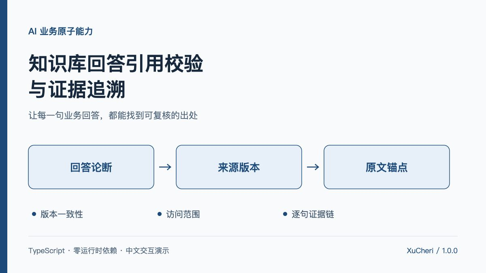

# 知识库回答引用校验与证据追溯

把一份知识库回答拆成声明，逐条检查它引用了哪个来源、哪个版本、哪一段原文，以及这个来源在检查时点是否仍然可用。结果分为 **结构通过 / 需要复核 / 发布阻断**，并保留从声明到原文的可解释证据路径。

**这是一套确定性引用规则，不是事实核验或幻觉检测模型。** 原文真实存在，也可能完全不能支持回答的含义；结构通过不意味着回答正确。



- 零运行时依赖，支持浏览器与 Node.js 18+；TypeScript 生成 ESM 和类型声明。
- 中文“引证台”演示可切换 7 种场景、逐声明查看原文高亮、导出审计 JSON。
- 所有演示机构、制度、数据和文档均为虚构；没有调用模型、在线知识库或真实业务系统。
- 包含 21 项可执行测试，覆盖 Unicode 范围、权限输出、版本、时效和误判边界。

## 快速开始

```bash
git clone https://github.com/XuCheri/ai-business-capabilities.git
cd ai-business-capabilities/evidence-trace
npm ci
npm test
npm run demo
```

打开 [本地演示](http://127.0.0.1:5177/demo/)。按 Ctrl+C 停止本次服务。

```bash
npm run check       # 类型检查
npm run build       # dist/index.js + dist/index.d.ts
npm run demo:build  # demo-dist/ 静态目录
```

演示以浏览器 ESM 加载核心，无 Vite 或第三方 UI 库。`demo-dist/` 可以交给任意 HTTP 静态服务；**直接用 file:// 双击 HTML 不保证能加载模块**。`PORT=5180 npm run demo` 可调整本地端口。开发服务器仅绑定 `127.0.0.1`，用于本地体验。

## 用它解决什么业务问题

回答中带了引用标记，并不等于引用可靠。常见问题包括：模型编造一段原文；文档确实存在但版本已经撤回；回答混用新旧制度；声明必需证据却没有引用；被引用的文档不属于当前租户；回答数字被改写而引用内容没有变化。

本能力在回答进入人工复核或发布流程之前执行可复现检查，让审核人明确看到“哪一条规则为何要求停下”。它不主动发布内容，不代替权限认证，也不连接任何模型。

## 检查流程与决策


| 检查 | 处理结果 |
| --- | --- |
| 必引声明没有引用 | 阻断 |
| 来源不存在、未许可或属于另一租户 | 统一返回 `SOURCE_UNAVAILABLE`，阻断，不返回来源元信息和正文 |
| 已授权来源没有请求版本 | 阻断，不回退当前版本 |
| 文档/版本已撤回，或版本尚未生效 | 阻断 |
| 版本已到期，或不是登记的当前版本 | 复核 |
| 引文不在指定版本正文中，或指定范围不匹配 | 阻断 |
| 引文重复出现且没有指定范围 | 复核，不擅自选中某一处 |
| 同一回答引用同一来源的多个版本 | 复核；提示版本混用，不声称已证明内容矛盾 |
| 声明的数字标记未出现在可用引文 | 复核；仅词面提示 |
| 所有规则没有发现问题 | 结构通过；不代表语义支持或事实正确 |

决策优先级为 `block > review > pass`。任意一条引用阻断都会阻断该声明及整个回答，即使同一声明另有可用引用。必引覆盖表示至少存在一个**唯一定位、且未被阻断**的引用；过期但已定位的引用可能计入覆盖，同时仍要求复核。覆盖率不等于可直接发布率。

## 可运行 API 示例

先执行 `npm run build`，将下列内容保存为能力目录内的 `example.mjs`，运行 `node example.mjs`：

```js
import { auditAnswer, exportAudit } from './dist/index.js';

const quote = '企业套餐每年包含4次上门巡检。';
const text = `青屿演示手册📘\n${quote}\n以上规则为虚构。`;
const start = text.indexOf(quote);
const report = auditAnswer({
  answerId: 'answer-001',
  tenantId: 'tenant-a',
  at: Date.UTC(2026, 9, 30),
  allowedSourceIds: ['service-handbook'],
  sources: [{
    id: 'service-handbook', tenantId: 'tenant-a', title: '青屿演示手册',
    currentVersionId: '2026.2',
    versions: [{
      id: '2026.2', text,
      validFrom: Date.UTC(2026, 6, 1),
      validUntil: Date.UTC(2027, 0, 1),
    }],
  }],
  claims: [{
    id: 'claim-1', text: quote,
    requiresCitation: true, // 必须由服务端业务策略决定，不相信模型自报。
    citations: [{
      sourceId: 'service-handbook', versionId: '2026.2', quote,
      anchor: { start, end: start + quote.length },
    }],
  }],
});

console.log(report.decision); // pass：只表示结构规则通过
console.log(report.claims[0].citations[0].anchor);
console.log(exportAudit(report));
```

`auditAnswer(request)` 不修改输入，返回结构化审计结果。没有网络、持久化或计时器依赖。必须显式传入检查时点 `at`，以便同一输入得到可复现结果。`exportAudit(report)` **只是 JSON 序列化**，应只传入未经追加私密字段的 `auditAnswer()` 结果；它不会再次脱敏任意对象。

## 数据合同

### 来源、版本与访问范围

```ts
interface EvidenceSource {
  id: string;
  tenantId: string;
  title: string;
  currentVersionId?: string;
  withdrawnAt?: number;
  versions: {
    id: string;
    text: string;
    validFrom?: number;
    validUntil?: number;
    withdrawnAt?: number;
  }[];
}
```

所有时间为非负安全整数 Unix 毫秒。有效期是 `[validFrom, validUntil)`；缺省边界表示没有配置该方向的限制。到 `withdrawnAt` 时点即按已撤回处理。来源和版本 ID 是业务提供的不可变身份，本能力不负责获取原件或验证签名。

同租户来源 ID、同文档版本 ID、同回答声明 ID 必须唯一。当前版本指针若配置，须指向登记版本。注册表属于**可信接入输入**，先做完整结构预检，再对引用查找实施租户和允许列表限制。

### 声明与引用

```ts
interface Claim {
  id: string;
  text: string;
  requiresCitation: boolean;
  citations: {
    sourceId: string;
    versionId: string;
    quote: string;
    anchor?: { start: number; end: number };
  }[];
}
```

`requiresCitation` 必须由服务端可信业务规则决定。不能允许生成模型或不可信客户端设置 `false` 来绕过引用要求。需要时可在适配层把全部业务声明强制设为 `true`。

偏移采用 **JavaScript UTF-16 code unit，0 基、终点排他的 `[start, end)`**。不是字节索引，不是 Unicode code point，也不是用户感知字符数。`📘`.length 为 2。起止位置不得切开 UTF-16 代理对；本实现不校验完整字素簇边界，例如组合附加符号可以单独占范围。调用方应按产品需要进一步限制字素边界。

引文严格匹配指定版本的完整纯文本，不做 Unicode 归一化、空白折叠、OCR 修复或省略号补全。只有标题、提示词上下文中出现的内容不能当作正文证据。不传 `anchor` 时，唯一精确匹配会自动定位；多处匹配要求补范围。

**没有接入任何模型供应商的原生 citation 协议。** PDF 页码、UTF-8 字节偏移、Unicode code point 或供应商字符偏移必须先经适配层转换，并针对文本提取版本测试，不能直接当成本协议。

### 输出

`AuditReport` 包含决策、规则声明、覆盖统计、逐声明发现、逐引用发现、已授权来源快照与版本混用提示。每个成功锚点包含 `start/end/offsetUnit/quote`，可直接高亮其 `document` 中的原文。

不可访问引用只保留调用方的引用序号与统一错误，不返回它的 sourceId、标题、版本、quote 或 document。**声明文本本身是调用方提供的回答内容，会原样保留**；若模型已将秘密写进声明，本能力不会删除它，也不是输出 DLP 系统。

## 数字检查的实际边界

数字粗检提取数字字面标记，例如 `4`、`09`、`18`、`25%`；将声明中的标记与唯一锚定、未被阻断的引文标记比较。可以通过 `checkNumbers: false` 关闭。

它不识别中文数字，不核对单位、不处理四舍五入、加减计算、正负号、区间与口径，也不理解否定关系。相同数字可能对应完全不同的指标。

例如，原文“企业套餐每年包含4次上门巡检”，回答“企业套餐不包含4次上门巡检”，仍可能结构通过。测试特意保留这个案例，防止把能力包装成语义蕴含或事实验证。

## 演示与测试设计

| 场景 | 预期 |
| --- | --- |
| 完整引用 | 3 条声明都能定位到授权的有效正文，结构通过 |
| 伪造引文 | 声称全年每日受理，与原文不匹配，阻断 |
| 来源过期 | 字面仍匹配，但来源有效期已到，复核 |
| 跨租户引用 | 不返回目标来源内容，阻断 |
| 版本混用 | 同一回答使用新旧版本，复核 |
| 数值待核对 | 回答写 8 次，原文为 4 次，复核 |
| 文档撤回 | 已撤回文档不能再作为发布证据，阻断 |

21 项 Node 内置测试覆盖：精确定位、emoji 与非法范围、Unicode 非归一化、重复引文消歧、伪造引文、租户隔离与不可用输出一致性、固定版本不回退、有效期与撤回边界、必引覆盖、数字检查局限、版本混用、标题不得冒作正文、输入预检、纯函数与 JSON 导出。

测试全部在本地执行，不构成真实知识库权限服务、模型质量、并发吞吐、生产发布流程或渗透测试的验收。

## 正式接入还需要什么

1. 从可信认证会话获取租户与操作人，根据后端 ACL 产生 `allowedSourceIds`；不能直接信任前端传入的权限字段。
2. 在服务端取得可访问文档，保存不可变版本文本、提取方式、哈希与有效期；版本内容变更必须生成新版本 ID。
3. 将回答拆分为可审核声明，为必引策略负责；这个包不执行文本分句、模型调用、检索或语义支持判断。
4. 对异常输入、声明/引用数量和文档尺寸设限；当前实现进行线性字符串扫描并返回完整授权正文，未做大规模吞吐优化。
5. 持久化审计结果、规则版本和人工复核人；将阻断结果接到真实发布网关，而不是仅在前端展示红色提示。
6. 如需防止模型回答泄漏、恶意文档提示注入、敏感信息外发，另行配置检索侧授权、模型调用隔离及输出内容检查。

演示的整个虚构注册表位于前端 JavaScript 中，开发者工具可以查看其模拟内容。它展示的是**审计结果的权限输出约束**，不把前端隐藏当成机密隔离。生产环境不应把未授权原文下发到浏览器。

## 目录

```text
src/index.ts          领域 API 与检查规则
dist/                 ESM、类型声明与源映射
demo/                 中文交互演示与虚构场景
scripts/              本地静态服务与演示构建
tests/                21 项领域测试
publication/          能力平台四栏填写材料
capability.json       标题、分类、粒度与标签
```

本包尚未单独发布到 npm；从仓库使用源码、构建产物或通过本地包方式接入。许可证与仓库发布信息以仓库根目录为准。
